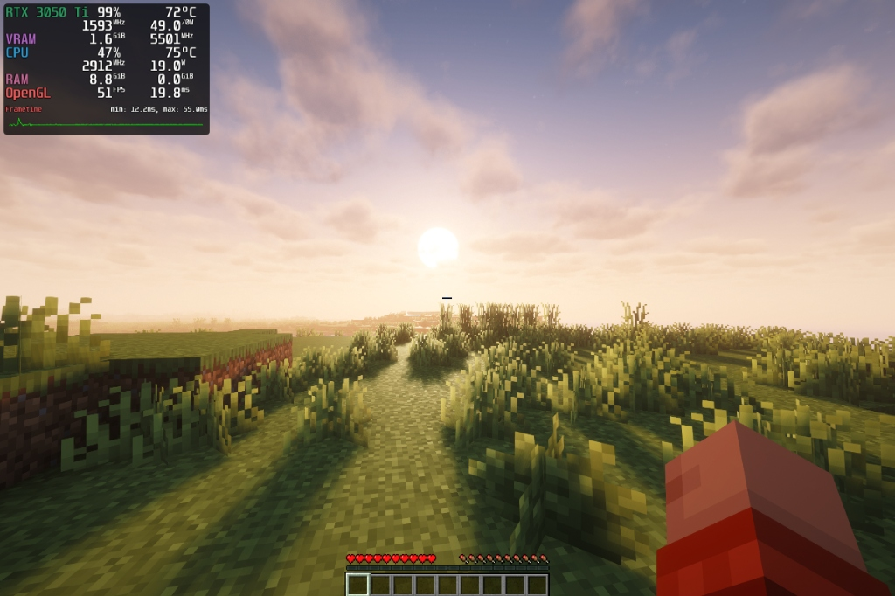

# Surface Laptop Studio dGPU 10W Fix, D3cold Deep Sleep & 50W Power Unlock

A complete, production-ready solution for the **Microsoft Surface Laptop Studio** (and SLS 2) running Linux to:
1. **Fix the 10W Throttle Bug**: Stop the dGPU from waking up permanently crippled to **10W / P8 state** upon resuming from sleep.
2. **Unlock Full 50W TGP (Dynamic Boost)**: Break past the 35W base lock up to the full **50.0 W** hardware limit via ACPI `SGPC` power steering, nearly **doubling gaming FPS**.
3. **Enable True D3cold Deep Sleep**: Achieve **0W / 0 MHz** idle power draw, dramatically saving battery life and keeping the laptop cool.
4. **Memory Overclocking Sweet Spot**: Boost GDDR6 memory bandwidth safely with a **+650 MHz (6.15 GHz)** offset.

---

## 🚀 Performance Proof & In-Game Benchmarks

Tested live on **Surface Laptop Studio (Model 1964)** with an Intel Core i7-11370H and NVIDIA GeForce RTX 3050 Ti Mobile running *Minecraft with heavy BSL / Iris Shaders* under Arch Linux (`linux-surface` kernel 7.2.15):

| Metric | Before (Stock 35W Base Floor) | After (50W TGP Unlocked) | Delta |
| :--- | :---: | :---: | :---: |
| **GPU Power Draw** | 34.0 W (hard limit) | **49.0 W** | **+44.1%** |
| **GPU Core Clock** | 1216 – 1243 MHz | **1593 – 1740 MHz** | **+31.2%** |
| **Average Framerate** | 26 – 29 FPS | **51 FPS** | **+88.9% (Almost 2x!)** |
| **Frametime** | 34.2 – 37.9 ms | **19.8 ms** | **-47.8% (Smooth)** |
| **GPU Temperature** | 63°C | **72°C** | Stable & well within thermal spec |

### Before: Locked at 35W Base (34.0W / 1216 MHz / 29 FPS)


### After: Unlocked to 50W (49.0W / 1593 MHz / 51 FPS)


---

## 🧠 Root Cause Analysis & ACPI Reverse Engineering

### 1. The 10W Sleep Throttle Bug
On the Surface Laptop Studio under Linux, enabling Runtime D3 (RTD3 / D3cold) causes the discrete GPU (RTX 3050 Ti) to wake up locked to a hard **10W power limit (P8 state)**, resulting in unplayable ~10 FPS in games and 3D workloads.

Disassembling Microsoft's ACPI tables (`DSDT` and `SSDT7`) revealed the culprit:
```asl
PowerResource (PRPD, 0x00, 0x0000)
{
    Method (_ON, 0, Serialized)
    {
        ...
        If ((ToInteger (\_SB.SGPC.SACT) == One))
        {
            Notify (\_SB.SGPC, 0x81) // Normal power-on notification
        }
        Else
        {
            Notify (\_SB.PC00.RP09.PXSX, 0xD5) // EMERGENCY THROTTLE TO 10W!
        }
    }
}
```
* Device `\_SB.SGPC` (ACPI HID: **`MSHW0216`**) is the **Microsoft Surface Graphics Power Controller**.
* At boot, `SACT` is initialized to `0`.
* On Windows, Microsoft's proprietary `SurfaceDgpuPwr.sys` driver initializes `MSHW0216`.
* On Linux, **no driver existed for `MSHW0216`**. Because `SACT` remained `0`, every single wake event from D3cold fired ACPI notification `0xD5`, permanently clamping the GPU to 10W.

### 2. The 35W vs 50W Power Limit Ceiling
The GA107M mobile GPU has a **35W Base TGP** and a **50W Maximum TGP** (+15W Dynamic Boost). However, under Linux, `nvidia-smi` always reported:
```text
GPU Ceiling Power Limit
    Current Power Limit : 35.00 W
    Default Power Limit : 35.00 W
    Max Power Limit     : 50.00 W
```
In `SSDT7`, `\_SB.SGPC` defines:
```asl
Name (PWRA, 0xFF88)  // AC Power Offset: 0xFF88 = -120 (-15.0W!)
Name (SPWR, Zero)    // Target TGP power: 0W
Name (GAPW, 0x23)    // AC Base TGP: 35W (0x23 = 35)
Name (GAMX, 0x32)    // AC Max TGP: 50W (0x32 = 50)
```
1. Function 2 of NVPCF reads `PWRA` and feeds `ctgpOffsetmW` into the NVIDIA driver in 125 mW units (`-120 * 125 mW = -15W`).
2. SBIOS boots with `PWRA = 0xFF88` (-15W offset), suppressing any boost over the base 35W ceiling.
3. By invoking `\_SB.SGPC._DSM` (UUID: `bbbf19da-988b-8b74-29ce-d12810bfe9d90`):
   - **Function 7 (`Arg3 = 1`)**: Sets `SACT = 1`, initializes the hardware arbiter, and emits unthrottle event `0xD1`.
   - **Function 3 (`Arg3 = 0x78 = 120`)**: Sets `PWRA = +120` (`+120 * 125 mW = +15,000 mW = +15W` cTGP boost offset!).
   - **Function 2 (`Arg3 = 0x0320 = 800`)**: Sets target TGP `SPWR = 800 * 0.0625 W = 50.0 W` and fires ACPI notification `0xC0` to `NPCF`.
   - **Function 1 (`Arg3 = 1`)**: Enables SMF Boost.
4. When `0xC0` is received by the NVIDIA driver (`nv_acpi_nvpcf_event`), the driver evaluates Function 2, sees the `+15,000 mW` offset, calls `CONFIGURE_TURBO_V2`, and immediately updates:
   ```text
   Current Power Limit : 50.00 W
   ```

---

## 📦 Automated Installation

Clone this repository and run the automated installer:

```bash
git clone https://github.com/besiple/surface-laptop-studio-dgpu-fix.git
cd surface-laptop-studio-dgpu-fix
chmod +x install.sh
sudo ./install.sh
sudo reboot
```

### What `install.sh` does:
1. Installs and loads the `acpi_call` kernel module.
2. Deploys `/usr/local/bin/surface-dgpu-init` to configure `MSHW0216` (50W TGP + SACT=1 unthrottle).
3. Configures `surface-dgpu-init.service` and systemd sleep hook (`/usr/lib/systemd/system-sleep/surface-dgpu-init.sh`) so the GPU stays unlocked across boots, reboots, and sleep resumes.
4. Enables runtime power management (RTD3) in `/etc/modprobe.d/nvidia-runtimepm.conf` and `/etc/udev/rules.d/80-nvidia-pm.rules` for **0W D3cold idle**.
5. Rebuilds your initramfs (`mkinitcpio`, `dracut`, or `update-initramfs`).

---

## ⚡ Memory Overclock (+650 MHz / 6.15 GHz)

The RTX 3050 Ti Mobile memory runs at 5501 MHz default. Testing demonstrated:
* Default: 5501 MHz (~740 FPS in `glmark2`)
* +500 MHz: 6001 MHz (~775 FPS)
* **+650 MHz (6151 MHz / 6.15 GHz): ~791 FPS** *(Optimal sweet spot without EDC error-correction overhead)*
* +750 MHz: 6251 MHz (~789 FPS — EDC latency begins degrading throughput)

Apply dynamically with `nvidia-settings`:
```bash
nvidia-settings -a "[gpu:0]/GPUMemoryTransferRateOffsetAllPerformanceLevels=1300"
```

---

## 🔍 Verification

After rebooting:

```bash
# 1. Verify 50.00 W Current Power Limit:
nvidia-smi -q -d POWER | grep -A 5 "GPU Ceiling Power Limit"
# Output:
#     GPU Ceiling Power Limit
#         Current Power Limit : 50.00 W
#         Default Power Limit : 35.00 W
#         Max Power Limit     : 50.00 W

# 2. Verify D3cold deep sleep in idle (0W / 0MHz):
cat /sys/bus/pci/devices/0000:f3:00.0/power/runtime_status
# Output: suspended

# 3. Check live power & performance in game or benchmark:
mangohud prime-run glmark2
# or run any game via Steam with MANGOHUD=1 %command%
```

---

## 📚 Technical Documentation & Research

Detailed technical writeups and reverse engineering dumps are preserved in the `docs/` folder:
* [`docs/SGPC_50W_UNLOCKED.md`](docs/SGPC_50W_UNLOCKED.md): Full technical breakdown of the `MSHW0216` power steering registers, ACPI notify codes (`0xC0`, `0xD1`, `0xD5`), and driver PMGR Turbo V2 evaluation.
* [`docs/acpi/SSDT7.dsl`](docs/acpi/SSDT7.dsl): Disassembled ACPI table containing `\_SB.SGPC` and `\_SB.NPCF`.
* [`docs/OPUS_DIAGNOSTICS_REPORT.md`](docs/OPUS_DIAGNOSTICS_REPORT.md): Joint reversing notes with Claude Opus on `nvidia-powerd` NVPCF tables.

---

## 🤝 Credits & Acknowledgements

* **besiple** — Research, reversing, hardware testing, and repository author.
* **Google DeepMind Antigravity & Claude Opus 5.5** — Collaborative ACPI reverse engineering, driver source analysis, and disassembly.
* **Linux-Surface Team** — Foundation for Surface hardware support on Linux.
