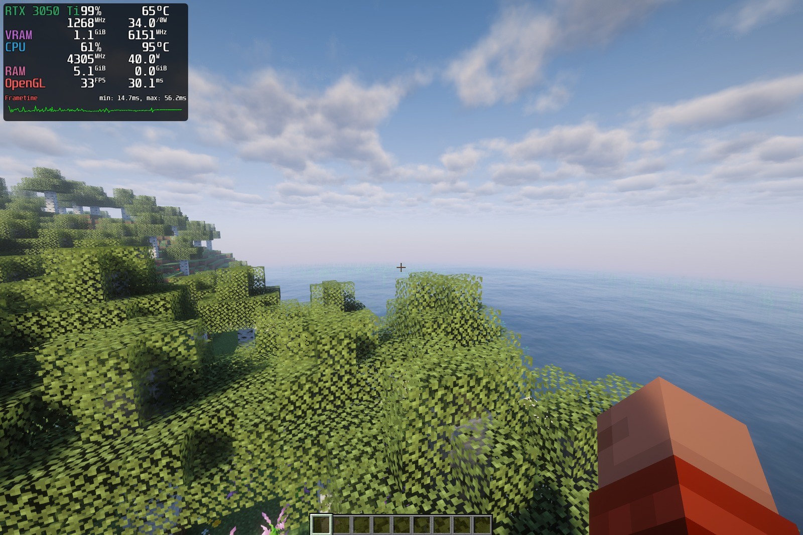
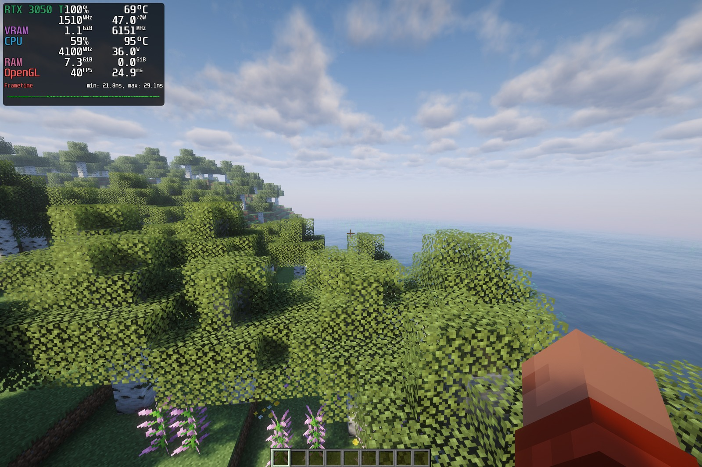

# Surface Laptop Studio dGPU Fix (10W Bug, D3cold & 50W Unlock)

Fixes NVIDIA RTX 3050 Ti power management on the **Microsoft Surface Laptop Studio 1 (Model 1964)** under Linux:

- **10W Sleep Throttle Fix:** Prevents the dGPU from waking out of `D3cold` stuck at 10W (`P8` state).
- **D3cold Idle Sleep:** Enables Runtime D3 (`0W` / `0 MHz` idle draw) with Wayland sleep stability.
- **50W Dynamic Boost (Optional):** Unlocks the full 50W TGP ceiling on AC power (up from the 35W base limit) via ACPI `SGPC` steering + an optional `nvidia-open-dkms` patch.
- **+650 MHz VRAM Overclock (Optional):** Applies a 6.15 GHz memory clock offset via NVML (works natively on Wayland, no `nvidia-settings` / X11 required).

> **Note:** Tested on Surface Laptop Studio 1 (i7-11370H + RTX 3050 Ti). Surface Laptop Studio 2 is currently untested.

---

## Quick Start

### Requirements
- `linux-surface` kernel (recommended for full Surface ACPI support).
- **AC charger connected** for 50W mode (on battery, the Surface EC hardware clamps the GPU to 35W).
- `nvidia-open-dkms` — only required if you opt into the 50W Dynamic Boost patch. Standard vendor drivers work fine for the 10W fix + 35W stock TGP.

### Install
```bash
git clone https://github.com/besiple/surface-laptop-studio-dgpu-fix.git
cd surface-laptop-studio-dgpu-fix
chmod +x install.sh
sudo ./install.sh
sudo reboot
```

Running `sudo ./install.sh` without flags starts interactive mode and prompts for both optional features. For non-interactive installs, pass flags directly:

| Flag | Effect |
| :--- | :--- |
| `--nvpcf-patch` / `--no-nvpcf-patch` | Patch `nvidia-open-dkms` for 50W Dynamic Boost, or keep stock drivers at 35W (still fixes the 10W bug). |
| `--mem-oc` / `--no-oc` | Enable `+650 MHz` GDDR6 overclock (`6151 MHz`), or keep stock `5501 MHz`. |

```bash
# Full setup (50W Dynamic Boost + 6.15 GHz VRAM):
sudo ./install.sh --nvpcf-patch --mem-oc

# ACPI-only safe mode (10W fix + D3cold, stock 35W drivers & clocks):
sudo ./install.sh --no-nvpcf-patch --no-oc
```

---

## Benchmarks

Tested on **Surface Laptop Studio (Model 1964)** (i7-11370H, RTX 3050 Ti Mobile) running *Minecraft + BSL / Iris Shaders* on Arch Linux (`linux-surface` 7.2.15 & 7.3.4, `nvidia-open-dkms` 620.73.04):

| Metric | Stock (35W Base) | Unlocked (50W TGP) | Delta |
| :--- | :---: | :---: | :---: |
| **GPU Power** | 34.0 W | **47.0 – 50.0 W** | +38% to +47% |
| **Core Clock** | 1268 MHz | **1510 – 1740 MHz** | +19% to +37% |
| **Framerate** | 33 FPS | **40 – 51 FPS** | +21% to +55% |
| **Frametime** | 30.1 ms | **19.8 – 24.9 ms** | -17% to -34% |
| **Temperature** | 65°C | **69 – 72°C** | +4 to +7°C |

| Before: 35W Lock (34W / 1268 MHz / 33 FPS) | After: 50W Unlocked (47–50W / 1510 MHz / 40+ FPS) |
| :---: | :---: |
|  |  |

---

## Verification

After rebooting, confirm everything is active:

```bash
# 1. Check TGP ceiling (50.00 W with NVPCF patch, 35.00 W on stock driver):
nvidia-smi -q -d POWER | grep -A 5 "GPU Ceiling Power Limit"

# 2. Check D3cold deep sleep in idle (should print "suspended"):
cat /sys/bus/pci/devices/0000:f3:00.0/power/runtime_status

# 3. Check VRAM clock (6151 MHz if --mem-oc was enabled):
nvidia-smi -q -d CLOCK | grep -A 5 "Max Clocks"
```

To observe full 47–50W draw in real time, use a GPU-bound workload (e.g., Unigine Superposition or a modern 3D game with `MANGOHUD=1`); lightweight tests like `glmark2` are CPU-bound and won't saturate 50W.

---

## VRAM Overclock (Wayland / NVML)

The RTX 3050 Ti GDDR6 runs at `5501 MHz` stock. Benchmarks showed `+650 MHz` (`6151 MHz`) as the peak throughput point before GDDR6 EDC error correction degrades performance at `+750 MHz`.

Instead of `nvidia-settings` (which requires X11), `/usr/local/bin/surface-dgpu-init` sets the offset directly through `libnvidia-ml.so.1` via Python `ctypes`.

```bash
# Apply +650 MHz (+1300 MT/s effective) manually:
sudo python3 -c "import ctypes; nv=ctypes.CDLL('libnvidia-ml.so.1'); nv.nvmlInit(); h=ctypes.c_void_p(); nv.nvmlDeviceGetHandleByIndex(0, ctypes.byref(h)); nv.nvmlDeviceSetMemClkVfOffset(h, 1300); nv.nvmlShutdown()"

# Reset back to stock (0 offset):
sudo python3 -c "import ctypes; nv=ctypes.CDLL('libnvidia-ml.so.1'); nv.nvmlInit(); h=ctypes.c_void_p(); nv.nvmlDeviceGetHandleByIndex(0, ctypes.byref(h)); nv.nvmlDeviceSetMemClkVfOffset(h, 0); nv.nvmlShutdown()"
```

To disable the overclock permanently, re-run `sudo ./install.sh --no-oc`.

---

## Driver Updates & Uninstall

### After an NVIDIA Driver Update
Updating `nvidia-open-dkms` overwrites `/usr/src/nvidia-*` with unpatched upstream sources:
- **Re-apply 50W Boost:** Run `sudo ./install.sh --nvpcf-patch` (the script validates compatibility with `patch --dry-run` before touching files).
- **Do nothing:** The system boots normally on the unpatched driver — the 10W fix, D3cold idle, and 35W TGP keep working.

### Revert NVPCF Patch to Stock Driver
```bash
sudo pacman -S nvidia-open-dkms                            # Arch Linux
sudo dnf reinstall akmod-nvidia-open                       # Fedora
sudo apt install --reinstall nvidia-kernel-source-open     # Ubuntu / Debian
```

### Full Uninstall
Removes all scripts, systemd units, udev/modprobe rules, unmasks `nvidia-powerd`, resets VRAM offset and ACPI registers to 35W, and rebuilds initramfs:
```bash
sudo ./uninstall.sh
```

---

## How It Works (ACPI Reverse Engineering)

<details>
<summary><b>Click to expand DSDT / SSDT7 analysis (MSHW0216 & NVPCF)</b></summary>

### 1. Why the GPU Locks to 10W After D3cold
In `DSDT` / `SSDT7`, the power resource `PRPD._ON` checks `\_SB.SGPC.SACT` (`MSHW0216` — Microsoft Surface Graphics Power Controller):

```asl
PowerResource (PRPD, 0x00, 0x0000)
{
    Method (_ON, 0, Serialized)
    {
        ...
        If ((ToInteger (\_SB.SGPC.SACT) == One))
        {
            Notify (\_SB.SGPC, 0x81) // Normal wake
        }
        Else
        {
            Notify (\_SB.PC00.RP09.PXSX, 0xD5) // Emergency 10W throttle
        }
    }
}
```

On Windows, `SurfaceDgpuPwr.sys` sets `SACT = 1`. On Linux, no driver exists for `MSHW0216`, so `SACT` stays `0` and every wake from D3cold fires `0xD5`, clamping the GPU to 10W.

### 2. Why TGP Stops at 35W Instead of 50W
`\_SB.SGPC` boots with a `-15W` AC power offset (`PWRA = 0xFF88 = -120`, in 125 mW units):

```asl
Name (PWRA, 0xFF88)  // AC Power Offset: -120 * 125 mW = -15.0W
Name (SPWR, Zero)    // Target TGP: 0W
Name (GAPW, 0x23)    // AC Base TGP: 35W
Name (GAMX, 0x32)    // AC Max TGP: 50W
```

Invoking `\_SB.SGPC._DSM` (`bbbf19da-988b-8b74-29ce-d12810bfe9d90`) fixes both issues:
- **Fn 7 (`Arg3 = 1`):** Sets `SACT = 1`, clears negative offsets, fires unthrottle `0xD1`.
- **Fn 3 (`Arg3 = 0x78`):** Sets `PWRA = +120` (`+15,000 mW` cTGP boost offset).
- **Fn 2 (`Arg3 = 0x0320`):** Sets `SPWR = 50.0W` (`800 * 0.0625W`) and notifies `NPCF` (`0xC0`).
- **Fn 1 (`Arg3 = 1`):** Enables SMF Boost.

With the optional NVPCF patch in `patches/nvidia-nvpcf-surface.patch`, the NVIDIA driver processes the `0xC0` event, calls `CONFIGURE_TURBO_V2`, and raises `Current Power Limit` to `50.00 W`.

Full writeups and dumps:
- [`docs/SGPC_50W_UNLOCKED.md`](docs/SGPC_50W_UNLOCKED.md)
- [`docs/REVERSE_ENGINEERING_50W.md`](docs/REVERSE_ENGINEERING_50W.md)
- [`docs/acpi/SSDT7.dsl`](docs/acpi/SSDT7.dsl)

</details>

---

## Credits & License

- **besiple** — Research, ACPI reverse engineering, hardware validation, and maintenance.
- **Gemini 3.8 Antigravity & Claude Opus 5.5** — Collaborative ACPI analysis, driver patching, and disassembly.

Licensed under the [MIT License](LICENSE) — Copyright (c) 2026 **besiple**. Attribution and a link back to this repository must be retained in derivatives per the MIT License.
